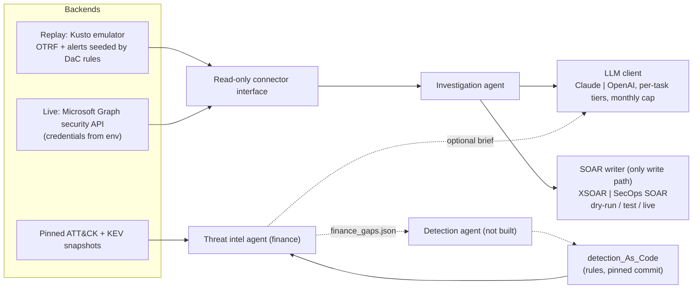

# ops-SOC

ops-SOC is a SOC platform with read-only LLM agents for Microsoft Defender and Microsoft
Sentinel, with the Sentinel workspace onboarded to the Defender portal. Results are written
to one SOAR, either Cortex XSOAR or Google SecOps SOAR.

**No live tenant exists.** Everything except API credentials is built and tested here, on
recorded [OTRF Security-Datasets](https://github.com/OTRF/Security-Datasets) loaded into the
Kusto emulator (Kustainer). No live Graph, Sentinel, SOAR or LLM call has been made. The
parts that would make such a call are labelled "not verified" below and in
[CLAUDE.md](CLAUDE.md).

| Agent | Status | What it does |
|---|---|---|
| Investigation | Built; not run with a real model | Takes a Defender / Sentinel alert, plans read-only hunting queries, records the evidence, reaches a cited verdict and writes a case report for the SOAR |
| Threat intel (finance) | Built; profile approved by the owner | Ranks the ATT&CK techniques used by finance-targeting groups, links KEV CVEs to them, and lists coverage gaps against detection_As_Code |
| Detection | **Not built** | Will turn intel gaps into detection_As_Code rule PRs |

## Contents
- [Architecture](#architecture)
- [Components](#components)
- [Setup](#setup)
- [Running in replay mode](#running-in-replay-mode)
- [Configuration](#configuration)
- [Tests and CI](#tests-and-ci)
- [Repository layout](#repository-layout)
- [What is not built or not verified](#what-is-not-built-or-not-verified)
- [Roadmap](#roadmap)
- [Conventions](#conventions)

## Architecture

The full decision is in [ADR 001](docs/decisions/001-architecture.md). In short:



The design rules:
- **Read-only connectors.** No response actions (isolate, disable, close, reassign). The
  SOAR writer is the only write path, and it runs in dry-run mode by default.
- **Model use is set per task, not per agent.** Hypotheses, evidence judgment and verdicts
  run on the `reasoning` tier (Claude Opus or the OpenAI top tier). Log summaries, reports
  and SOAR notes run on the `extraction` and `writing` tiers (Sonnet or below).
- **Tool and log output reaches a model as fenced data**, never as instructions.
- **Provenance on all data.** Every row is labelled recorded (with dataset and file),
  mapped by this project, or hand-written.

## Components

| Component | Code | Doc | Decision |
|---|---|---|---|
| Connectors: Graph security (alerts_v2, incidents, runHuntingQuery) and replay | `opssoc/connectors/` | [connectors.md](docs/components/connectors.md) | [ADR 003](docs/decisions/003-connectors-and-replay.md) |
| OTRF Sysmon to Defender `Device*` mapping (this project's mapping, labelled) | `opssoc/replay/sysmon_to_defender.py` | [otrf-defender-mapping.md](docs/components/otrf-defender-mapping.md) | ADR 003 |
| Replay alert seeding: detection_As_Code rules run per dataset, producing alerts_v2-shaped alerts | `opssoc/replay/` | [replay-alerts.md](docs/components/replay-alerts.md) | [ADR 004](docs/decisions/004-replay-alert-seeding.md) |
| LLM layer: Anthropic and OpenAI SDKs, tiers, prices, spend ledger and cap | `opssoc/llm/` | [llm-client.md](docs/components/llm-client.md) | [ADR 005](docs/decisions/005-llm-layer.md) |
| Investigation agent | `opssoc/agents/investigation/` | [investigation-agent.md](docs/components/investigation-agent.md) | [ADR 006](docs/decisions/006-investigation-agent.md) |
| Eval harness: 12 ground-truth cases, deterministic scoring | `opssoc/eval/` | [eval-harness.md](docs/components/eval-harness.md) | [ADR 007](docs/decisions/007-eval-harness.md) |
| Threat intel (finance): ATT&CK / KEV readers, finance analysis, brief | `opssoc/intel/`, `opssoc/agents/threat_intel/`, `intel/finance_profile.json` | [threat-intel.md](docs/components/threat-intel.md) | [ADR 008](docs/decisions/008-threat-intel-finance.md) |
| SOAR writer: XSOAR incident + entry; SecOps case comment | `opssoc/soar/` | [soar-writer.md](docs/components/soar-writer.md) | [ADR 002](docs/decisions/002-soar-writer.md) |

Agent definitions (prompt, budgets, tiers) are in `opssoc/agents/<agent>/agent.md`. Working
procedures for Claude Code are in `.claude/skills/`: `build-and-document`, `replay-data`,
`investigation-agent`, `llm-providers`, `eval-harness` and `threat-intel`.

### Threat intel in more detail
- **Inputs:**
  - MITRE ATT&CK Enterprise v20.1 and CISA KEV 2026.11.23, each pinned by commit and
    SHA-256.
  - A curated finance profile of 25 groups (6 primary, 19 listed). Each group carries a
    fetched public report that names a financial-sector victim or target. The owner
    approved the profile on 2026-11-25.
  - detection_As_Code at commit 51080aa, for coverage.
- **Outputs** (`build/intel/`):
  - `finance_priorities.json` / `.md`: technique priorities scored from group tiers, KEV
    links taken from ATT&CK text, and coverage (exact, partial or none).
  - `finance_gaps.json`: the detection agent's input, schema `opssoc.finance-gaps/1`.
- **Current result:** 291 techniques. Of the top 25, 3 are covered exactly (A1, A2, A4),
  1 partly (T1078), and 1 is pre-compromise (T1588.002); the other 20 are gaps. ATT&CK
  names 31 CVEs for these groups, 28 of them in KEV.
- **Model use:** a model writes only an optional brief, and every ID in it is checked
  against the data. No brief has been written yet (no LLM spend approved).

## Setup

You need Python 3.11 or later, plus Docker for the Kusto emulator. Replay seeding needs a
checkout of detection_As_Code at the pinned commit.

```bash
git clone https://github.com/HungryBrain-bot/ops-SOC.git && cd ops-SOC
python -m venv .venv && . .venv/bin/activate
pip install -e ".[dev,seed]"          # add ,llm for the Anthropic / OpenAI SDKs

# detection_As_Code at the pinned commit (see opssoc/replay/dac_bridge.py DAC_COMMIT)
git clone https://github.com/HungryBrain-bot/detection_As_Code.git ../detection_As_Code
git -C ../detection_As_Code checkout 51080aa733242325215be64f75a83926c4ac35ef
export OPSSOC_DAC_PATH=$PWD/../detection_As_Code

# Kusto emulator (CI pins the image by digest in .github/workflows/ci.yml)
docker run -d -e ACCEPT_EULA=Y -p 8080:8080 mcr.microsoft.com/azuredataexplorer/kustainer-linux
export OPSSOC_KUSTO_URL=http://localhost:8080
```

Extras:
- `dev`: pytest and ruff.
- `seed`: PyYAML, which detection_As_Code needs.
- `llm`: `anthropic>=2.13` and `openai>=3.58`. The tests use fakes and don't need it.

## Running in replay mode

Replay mode runs everything against recorded OTRF data in the emulator. It does not run
against a real tenant.

```bash
# 1. Data: fetch the pinned OTRF datasets, then seed alerts and load the emulator
python -m opssoc.replay fetch
python -m opssoc.replay seed --eval-rules     # writes data/replay/alerts.json, loads all tables

# 2. Investigation (no --alert lists alerts with no LLM call; --alert spends money)
python -m opssoc.agents.investigation
python -m opssoc.agents.investigation --alert <ID> --provider anthropic --soar xsoar --soar-mode test

# 3. Eval (cases: no LLM call; run spends money and needs --yes)
python -m opssoc.eval cases
python -m opssoc.eval run --provider anthropic --yes
python -m opssoc.eval score build/eval/<run>

# 4. Threat intel (no LLM call unless --brief)
python -m opssoc.agents.threat_intel fetch
python -m opssoc.agents.threat_intel check
python -m opssoc.agents.threat_intel analyse  # coverage and finance_gaps.json need OPSSOC_DAC_PATH

# 5. SOAR writer on the example case report
python -m opssoc.soar write --target xsoar  --report examples/case_report.json --mode test
python -m opssoc.soar write --target secops --report examples/case_report.json   # dry-run
```

Expected replay results:
- `seed` produces 7 alerts from the DaC rules (A1 2, A2 2, A3 2, A4 1) and 5 from the eval
  rules.
- `eval cases` matches all 12 ground-truth cases.

What each SOAR mode does:
- `dry-run` writes the requests to `build/soar/`, with auth redacted.
- `test` pushes over HTTP to a local stub server.
- `live` needs the target's credentials. The investigation CLI never uses live mode.

## Configuration

All configuration comes from environment variables. No secrets are stored in the repo; in
CI they are GitHub Actions secrets.

| Variable | Used by | Purpose |
|---|---|---|
| `OPSSOC_KUSTO_URL` | replay, engine tests | Kusto emulator URL (default `http://localhost:8080`) |
| `OPSSOC_DAC_PATH` | replay seeding, threat intel coverage | detection_As_Code checkout at the pinned commit |
| `ANTHROPIC_API_KEY` | Anthropic provider | Read by the SDK |
| `OPENAI_API_KEY` | OpenAI provider | Read by the SDK |
| `OPSSOC_ANTHROPIC_MODEL_REASONING` / `_EXTRACTION` / `_WRITING` | LLM layer | Override the model per tier (defaults Opus 5.5 / Sonnet 5.5 / Sonnet 5.5) |
| `OPSSOC_OPENAI_MODEL_REASONING` / `_EXTRACTION` / `_WRITING` | LLM layer | **Required** for OpenAI: there are no defaults |
| `OPSSOC_ANTHROPIC_EFFORT_<TIER>`, `OPSSOC_OPENAI_EFFORT_<TIER>` | LLM layer | Effort per tier (defaults: high for reasoning, low for the others) |
| `OPSSOC_LLM_PRICES` | spend ledger | JSON `{"model-id": [input_usd_per_mtok, output_usd_per_mtok]}`; **required for OpenAI models**, since only Anthropic prices are built in |
| `OPSSOC_LLM_MONTHLY_CAP_USD` | spend ledger | Monthly cap (default 100) |
| `GRAPH_TENANT_ID`, `GRAPH_CLIENT_ID`, `GRAPH_CLIENT_SECRET` | Graph connector (live) | App registration (client credentials). ADR 003 names `ThreatHunting.Read.All` for hunting; the permissions for reading alerts and incidents are not yet documented or verified |
| `XSOAR_API_URL`, `XSOAR_API_KEY`, `XSOAR_API_KEY_ID`, `XSOAR_INCIDENT_TYPE` | SOAR writer, live XSOAR | |
| `SECOPS_PROJECT`, `SECOPS_REGION`, `SECOPS_INSTANCE`, `SECOPS_ACCESS_TOKEN` | SOAR writer, live SecOps | |

Example OpenAI setup:

```bash
export OPENAI_API_KEY=...
export OPSSOC_OPENAI_MODEL_REASONING=<top-tier model id>
export OPSSOC_OPENAI_MODEL_EXTRACTION=<smaller model id>
export OPSSOC_OPENAI_MODEL_WRITING=<smaller model id>
export OPSSOC_LLM_PRICES='{"<top-tier model id>": [<in>, <out>], "<smaller model id>": [<in>, <out>]}'
```

Spend is recorded in `data/llm/spend.jsonl`. A call that would exceed the monthly cap is
refused before it is sent. Defaults and prices (fetched 2026-11-24) are in
`opssoc/llm/settings.py`.

## Tests and CI

```bash
python -m pytest        # 102 passed, 8 skipped locally (engine tests need the emulator)
ruff check .
```

| Test file | What it covers |
|---|---|
| `tests/test_soar.py` | Dry-run output, test push to the stub (XSOAR and SecOps), live credential check, ledger |
| `tests/test_connectors.py` | Read-only guard, Graph requests and errors (fake transport, responses written from docs), replay provenance |
| `tests/test_seed.py` | Seeded alert shape, evidence, stable IDs, rule selection |
| `tests/test_sysmon_mapping.py` | Sysmon to Defender mapping on a recorded OTRF extract |
| `tests/test_llm.py` | Tiers, prices, spend cap, Anthropic / OpenAI requests against fake SDK clients |
| `tests/test_investigation.py` | Agent loop with a scripted provider (test-only, not model output) |
| `tests/test_eval.py` | Ground truth integrity, case matching, scoring |
| `tests/test_threat_intel.py` | ATT&CK / KEV readers, profile and web-evidence checks, priorities, coverage, gap handoff, brief ID checks |
| `tests/test_intel_snapshots.py` | Profile and counts on the real pinned snapshots (skipped unless fetched) |
| `tests/test_replay_engine.py` | Replay in the real Kusto emulator (skipped unless `OPSSOC_KUSTO_URL` is set) |

CI (`.github/workflows/ci.yml`) runs on every push and PR:
- `test`: pytest, ruff, and a SOAR test push to the stub for each target.
- `replay-kusto`: Kustainer pinned by digest and DaC at the pinned commit. It fetches OTRF,
  seeds and loads, checks that the eval cases cover every alert, and runs the engine tests.
  It uploads the `replay-alerts` artifact.
- `intel`: fetches the snapshots, runs the snapshot tests and the profile check, then runs
  `analyse` with DaC coverage. It uploads `finance-priorities`, which includes
  `finance_gaps.json`.

No CI job calls an LLM, a live Graph or Sentinel API, or a live SOAR.

## Repository layout

```
opssoc/
  agents/investigation/   agent.md, agent loop, CLI
  agents/threat_intel/    agent.md, brief, report, CLI
  connectors/             read-only interface, Graph, replay
  eval/                   ground truth, eval rules, cases, scoring
  intel/                  snapshots, ATT&CK and KEV readers, finance analysis
  llm/                    providers, settings, spend ledger, scripted (tests only)
  replay/                 OTRF datasets, mapping, Kusto loader, DaC bridge, seeding
  soar/                   XSOAR and SecOps writers, stub server
  case.py                 case report model
intel/finance_profile.json   curated finance groups with web evidence (approved)
docs/decisions/           ADRs 001-008 (append-only, dated amendments)
docs/components/          one doc per component
examples/case_report.json example input for the SOAR writer
tests/                    pytest suite and fixtures
BUILD_LOG.md              append-only build log
CLAUDE.md                 project instructions and current status
```

## What is not built or not verified

**Not built:**
- The detection agent.
- The Sentinel fallback connector (Log Analytics query API and ARM incidents). The Graph
  connector is the only live connector.
- The case store. Investigation records are JSON files in `build/`.
- CISA sources beyond KEV.

**Not verified** (no live call has been made; each needs one, logged in BUILD_LOG.md):
- Graph: any live call, and the `categories` value format. Seeded alerts use CamelCase
  tactics.
- XSOAR: any live call, and whether the incident ID equals the investigation ID.
- Google SecOps SOAR: any live call, and the `caseComments.create` URL and body fields.
- LLMs: any live call. The owner has not approved spend yet.
- How well a real model investigates. The eval has not been run with a real model.
- OpenAI request shape against the real API.
- Defender's registry hive format in the `Device*` mapping. The mapping is this project's,
  not Microsoft's.

**Limits by design:**
- The threat intel does not say who is targeting a given organisation, or how likely an
  attack is.
- "Covered" means a DaC rule maps the technique, not that it is deployed, active, or
  detects every procedure.
- The web-evidence quotes in the finance profile came through a summarising fetch tool,
  so they are not checked byte-for-byte.
- The two benign eval labels are this project's judgment, approved by the owner on
  2026-11-25. The ten true-positive labels come from OTRF metadata.

## Roadmap
1. **Detection agent:** read `finance_gaps.json` and propose detection_As_Code rules as
   PRs. Each rule ships with its docs, samples and evidence under DaC's conventions, and
   needs the owner's approval for scope.
2. **First real-model eval run,** once the owner approves spend. Then compare models,
   prompts and budgets on the 12 cases.
3. **Live verification:**
   - The first logged Graph, Sentinel and SOAR calls against a test tenant.
   - Close the "not verified" list above.
4. **Sentinel fallback connector** (Log Analytics and ARM incidents) and a case store.
5. **More intel sources:** CISA advisories beyond KEV (an open question in ADR 001).

## Conventions
This project follows detection_As_Code's conventions; the full list is in
[CLAUDE.md](CLAUDE.md).
- **ADRs:** only design decisions go in ADRs. ADRs and BUILD_LOG.md are append-only.
- **Component docs:** each one says what the component does, how, why this method, and what
  it does not do.
- **Citations:** only from fetched primary sources, with the fetch date. Never from memory.
- **Checks:** each check is described by exactly what it tests and what it misses.
- **Secrets:** only in environment variables. No real keys, tenant names or customer data.
