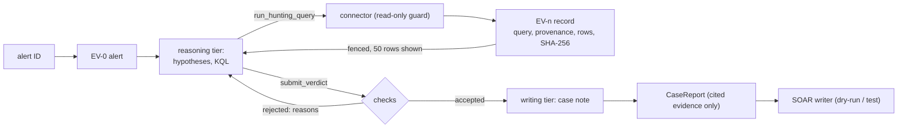

# Investigation agent

Code: `opssoc/agents/investigation/` (definition and prompt in `agent.md`, factor checklist
in `factors.json` and `factors.py`). Decisions: ADR 006, ADR 009 (factors, telemetry, analyst
loop; step 1 built). LLM layer: `llm-client.md`.

## What it does
Takes one alert ID, reads the alert through a read-only connector (Graph live, or replay),
gathers evidence with KQL hunting queries it writes itself, and ends with a verdict
(`true_positive`, `benign`, `inconclusive`) whose timeline and findings cite evidence IDs.
The citations are checked before the verdict is accepted. Output: an investigation record
and a case report the SOAR writer can send.

## How
```
pip install -e ".[llm]"
python -m opssoc.agents.investigation                       # list alerts (no LLM call)
python -m opssoc.agents.investigation --alert rpl-... \
    [--provider anthropic|openai] [--soar xsoar --soar-mode test]
```
Writes `build/investigations/<case>.investigation.json` and `<case>.case.json`.



Factor checklist (ADR 009, `factors.json`, set `endpoint-process` v1): F1 lineage, F2
command, F3 follow-on, F4 account, F5 prevalence, F6 spread, F7 related alerts, F8 benign
explanation, F9 asset context (analyst only), F10 timing. F1, F2, F3 and F8 are high
weight. The opening message lists them, and `submit_verdict` must answer each with a
state (`malicious_indicator`, `benign_indicator`, `neutral`, `unknown_no_telemetry`,
`unknown_not_checked`), a reason and evidence IDs. The weights are this project's
judgment and are not calibrated.

Checks on a submitted verdict (`check_verdict` = `check_citations` + `check_factors` +
`check_decision`):
- every cited evidence ID was issued in this investigation;
- every timeline entry and finding cites at least one ID;
- each timeline time is ISO 8601 and its minute appears in the rows it cites;
- `true_positive` and `benign` have at least one finding;
- verdict and confidence are from the allowed values;
- every factor of the set is answered exactly once. A known state cites evidence.
  `unknown_no_telemetry` cites a `coverage` record. F9 in a known state cites an
  `analyst` record;
- at least two hypotheses, at least one with `explanation: benign`;
- `true_positive`: a high-weight factor is `malicious_indicator` and cites evidence other
  than the alert or incident record;
- `benign`: F1 or F8 is `benign_indicator`, and no high-weight factor is
  `unknown_no_telemetry`. Missing data blocks clearing an alert, but it does not block
  a true positive;
- `high` confidence: no high-weight factor is unknown.

After acceptance, the code computes `factor_tally` (state counts by weight, plus each
factor's state and citations) and stores it in the investigation record. This is a report
for the analyst. It does not set the verdict.

Budgets (in `agent.md`): 24 model turns, 20 queries, USD 3.00 per case; the monthly cap
applies on top. When a budget is reached the model is asked once for a verdict; otherwise
the case is `inconclusive: stopped: budget`.

## Why this method
Evidence records with hashes and validated citations let an analyst trace every claim to
the query and rows behind it. Asking for competing hypotheses, including a benign one,
counters anchoring on the alert. Fencing tool output keeps attacker-controlled log text
from being read as instructions.

## What it does not do
- It does not check that a finding or a factor answer is true of the rows it cites,
  only that the rows exist, are of the right kind, and that the timeline times appear in
  them. The eval harness and analyst review cover correctness.
- A model can still mark a factor `neutral` with a citation it did not really examine;
  the checks see the citation, not the reasoning.
- No telemetry probe yet (ADR 009 step 2), so `unknown_no_telemetry` cannot be used, and
  no analyst records yet (step 4), so F9 stays `unknown_not_checked`.
- One factor set, for endpoint process alerts only.
- No response actions and no live SOAR writes from its CLI.
- It does not remember earlier cases or learn from analyst feedback.
- It investigates one alert; `get_incident` shows related alerts but the verdict is for
  the alert.
- Fencing reduces prompt injection risk; it does not remove it.
- How well a real model investigates is not measured yet (no LLM spend in this PR).
