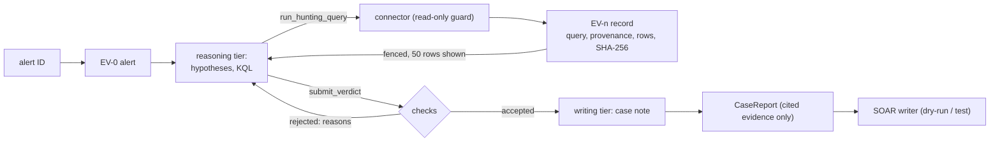

# Investigation agent

Code: `opssoc/agents/investigation/` (definition and prompt in `agent.md`). Decision:
ADR 006. LLM layer: `llm-client.md`.

## What it does
Takes one alert ID, reads the alert through a read-only connector (Graph live, or replay),
gathers evidence with KQL hunting queries it writes itself, and ends with a verdict
(`true_positive`, `benign`, `inconclusive`) whose timeline and findings cite evidence IDs.
The citations are checked before the verdict is accepted. Output: an investigation record
and a case report the SOAR writer can send.

## How
```
pip install -e ".[llm]"
python -m opssoc.agents.investigation                       # list alerts (no LLM call)
python -m opssoc.agents.investigation --alert rpl-... \
    [--provider anthropic|openai] [--soar xsoar --soar-mode test]
```
Writes `build/investigations/<case>.investigation.json` and `<case>.case.json`.



Checks on a submitted verdict (`check_verdict`):
- every cited evidence ID was issued in this investigation;
- every timeline entry and finding cites at least one ID;
- each timeline time is ISO 8601 and its minute appears in the rows it cites;
- `true_positive` and `benign` have at least one finding;
- verdict and confidence are from the allowed values.

Budgets (in `agent.md`): 24 model turns, 20 queries, USD 3.00 per case; the monthly cap
applies on top. When a budget is reached the model is asked once for a verdict; otherwise
the case is `inconclusive: stopped: budget`.

## Why this method
Evidence records with hashes and validated citations let an analyst trace every claim to
the query and rows behind it. Asking for competing hypotheses, including a benign one,
counters anchoring on the alert. Fencing tool output keeps attacker-controlled log text
from being read as instructions.

## What it does not do
- It does not check that a finding is true of the rows it cites, only that the rows
  exist and the timeline times appear in them. The eval harness and analyst review cover
  correctness.
- No response actions and no live SOAR writes from its CLI.
- It does not remember earlier cases or learn from analyst feedback.
- It investigates one alert; `get_incident` shows related alerts but the verdict is for
  the alert.
- Fencing reduces prompt injection risk; it does not remove it.
- How well a real model investigates is not measured yet (no LLM spend in this PR).
