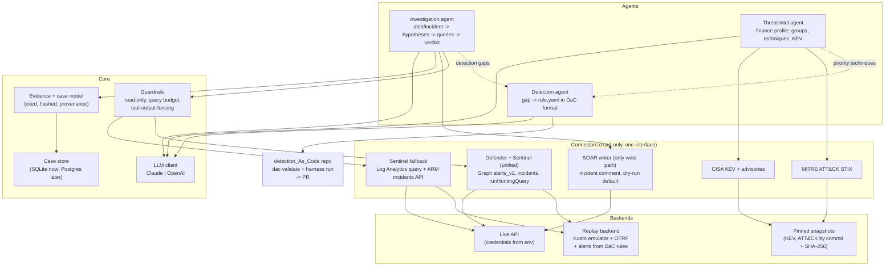

# 001. Platform architecture: three read-only agents over one connector layer

## Status
Proposed (2026-11-24). Becomes Accepted when the owner (Venu) approves it in the project thread.

## Context
The OpsMind hackathon build is a scripted replay: the request's `scenario_id` picks the
evidence, verdict and remediation, and every tool returns fixture data (review of
`HungryBrain-bot/opsmind-hackathon` at b85ce99, 2026-11-24). The owner wants a real SOC
platform instead, in a new repo, decided in the project thread on 2026-11-24:

- Three agents: **investigation**, **threat intelligence** (finance sector), **detection
  engineering** (detection-as-code). No hunting agent.
- Targets: **Microsoft Sentinel** (SIEM) and **Microsoft Defender** (EDR / XDR).
- No live tenant. Build up to the point where adding API credentials is the only step left.
- Test data: **OTRF Security-Datasets**.
- Threat intel sources: **CISA** and **MITRE ATT&CK**.
- LLM: **Claude and OpenAI**, switchable.
- Conventions copied from `HungryBrain-bot/detection_As_Code` (DaC): CLAUDE.md,
  BUILD_LOG.md, ADRs, component docs, skills, recorded vs. hand-written labelling.

Further decisions by the owner, 2026-11-24 (project thread):

- The target Sentinel workspace is treated as **onboarded to the Defender portal**
  (owner's deadline: January 2027). Microsoft's own retirement date for Sentinel in the
  Azure portal is 2027-03-31 per a Microsoft Q&A moderator answer of 2026-03-16
  ([Q&A](https://learn.microsoft.com/en-us/answers/questions/5824732/what-is-the-new-date-for-microsoft-sentinel-retire));
  not yet checked against the Learn overview page.
- **Map OTRF Sysmon to Defender `Device*` tables**, labelled as this project's mapping.
- **Models:** investigation reasoning on the top-tier model (Claude Opus); log fetching,
  formatting, documentation and SOAR write-up on a mid or small model (Claude Sonnet or
  below). OpenAI equivalents set the same way in settings.
- **LLM spend cap: USD 100** (assumed per month).
- Agents **write investigation results to SOAR** (target to be named; see Open questions).

Constraints found while checking sources (fetched 2026-11-24):

- OTRF is raw Windows Security / Sysmon / Entra event logs. It holds **no Sentinel
  incidents or alerts and no Defender `Device*` tables**. DaC maps it only to
  `SecurityEvent`, `Event` and the Entra tables; its Defender rows are hand-written
  (`harness/mapping.py`, `NATIVE_TABLES`).
- Defender alerts, incidents and advanced hunting are in Microsoft Graph v1.0:
  `GET /security/alerts_v2`, `GET /security/incidents`, `POST /security/runHuntingQuery`
  (permission `ThreatHunting.Read.All`). Sentinel alerts appear there only when the
  workspace is onboarded to the Defender portal
  ([Graph security API overview](https://learn.microsoft.com/en-us/graph/api/resources/security-api-overview?view=graph-rest-1.0)).
- Sentinel incidents have their own ARM API:
  `GET .../providers/Microsoft.SecurityInsights/incidents?api-version=2025-09-01`
  ([Incidents - List](https://learn.microsoft.com/en-us/rest/api/securityinsights/incidents/list?view=rest-securityinsights-2025-09-01)).
  Log queries go to the Log Analytics query API, which DaC's adapter already calls
  (`dac/adapters/sentinel.py`, scope `https://api.loganalytics.io/.default`).
- CISA KEV is published as JSON (mirror `cisagov/kev-data`, catalog 2026.11.23, 1,792
  entries; fields include `knownRansomwareCampaignUse`, `cwes`, `dateAdded`). It has **no
  sector field**. cisa.gov itself refused automated fetches from this environment.
- MITRE ATT&CK Enterprise STIX (v20.1, modified 2026-11-05) has 178 active groups and
  **no sector field**. 46 mention "financ" or "bank" in their description, which includes
  groups that are only "financially motivated". MITRE CTID's financial-sector project maps
  mitigations to the CRI Profile, not threat groups to the sector
  ([CTID](https://ctid.mitre.org/projects/tid-financial-sector/)).

## Decision

1. **Connectors.** Graph security API first: Defender and Sentinel alerts and incidents
   both come through `alerts_v2` / `incidents` once the workspace is in the Defender
   portal, and `runHuntingQuery` runs KQL over both products' tables. The Sentinel ARM
   incidents API and Log Analytics query API stay as a fallback only.
   One read-only `Connector` interface. Each connector builds the exact
   HTTP request and sends it through a swappable `Transport`, as DaC's adapters do
   (DaC ADR 002). Sentinel and Defender each have two backends:
   - **live**: the real API, credentials only from environment variables;
   - **replay**: the Kusto emulator (Kustainer) with OTRF loaded through DaC's mapping,
     so the agents run real KQL against a real engine.
   Agents cannot tell which backend they are on. Going live = setting credentials.
2. **Alerts for replay.** OTRF has no alerts, so a seeding step runs the DaC rules over
   the loaded OTRF data in the emulator and writes the matches as `SecurityAlert` /
   `SecurityIncident` rows (Sentinel shape) and Graph-shaped alert JSON (Defender shape).
   Every seeded alert records the rule and dataset it came from.
3. **Investigation agent.** Input: an alert or incident ID. Loop: plan hypotheses ->
   write KQL -> run it through the connector -> record each result as evidence ->
   the LLM judges support/contradiction **citing evidence IDs**, which are validated ->
   stop on sufficiency, budget or "inconclusive". No `scenario_id`, no pre-tagged
   evidence, no canned verdicts (the three blockers in the hackathon review).
4. **Threat intel agent (finance).** Pinned snapshots of ATT&CK STIX and CISA KEV,
   refreshed on demand. Finance relevance is **a curated, reviewed list** in
   `intel/finance_profile.yaml` (group IDs, each with the source sentence that ties it to
   finance targeting), seeded from the description match above and reviewed by the
   owner, because neither source has a sector field. Output: priority techniques and
   KEV entries, and a coverage gap list against the DaC rules.
5. **Detection agent.** Writes a rule folder in DaC's format (rule.yaml, attack.md,
   README.md, tests) into a DaC checkout, runs `python -m dac validate` and
   `python -m harness run --engine kusto`, and opens a PR on DaC. It does not
   reimplement the DaC pipeline, and nothing it writes merges without human review.
6. **LLM layer.** One `LLMClient` protocol (structured output against a Pydantic schema,
   token usage, cost) with Anthropic and OpenAI implementations. Model is chosen **per
   task, not per agent**: `reasoning` (hypotheses, evidence judgment, verdict) -> Opus
   tier; `extraction` (query result summarising, log field extraction) and `writing`
   (reports, SOAR notes, docs) -> Sonnet tier or below. A spend tracker refuses new LLM
   calls once the month's cost reaches the cap (default USD 100) and marks running cases
   "stopped: budget". Each agent's prompts are versioned files.
7. **Safety.** Every data connector is read-only: no response actions (isolate device,
   disable user, close incident) in scope. The one write path is the **SOAR writer**:
   it posts the investigation summary, evidence links and verdict as a case note /
   incident comment. It is dry-run by default (writes the request to `build/`, like DaC
   deploys) and never changes incident status, severity or assignment. Tool output is passed to the LLM as fenced
   data, never as instructions, because log content is attacker-controlled. Per-case
   query and token budgets.
8. **Repo layout and docs** follow DaC: `CLAUDE.md`, `BUILD_LOG.md` (append-only),
   `docs/decisions/`, `docs/components/`, `.claude/skills/`, pytest + ruff in CI.

## Alternatives considered
- **Evolve opsmind-hackathon.** Most of its backend is demo scaffolding; a new repo
  avoids carrying it. The owner chose a new repo.
- **Hand-written alerts for replay.** Faster, but then the investigation agent is only
  tested on scenarios we wrote, the hackathon's flaw again.
- **Map OTRF Sysmon to Defender `Device*` tables.** Would let Defender's advanced hunting
  run on recorded data, but the field mapping is ours, not Microsoft's. Allowed only
  if labelled "mapped by this project" in every result, like DaC's LLM tables.
- **Detection agent writes rules in this repo.** Duplicates DaC's schema, validator and
  harness; drift is certain.
- **An agent framework (LangGraph, CrewAI, vendor agent SDKs).** Hides the loop that has
  to be explainable to an analyst. Revisit if orchestration grows beyond three agents.

## Consequences
- Tests prove the requests match our reading of the vendor references and that the
  agents reason over real KQL results on recorded data. They do not prove a live tenant
  accepts the requests; that is "not verified" until a logged live call.
- Defender's EDR path has no recorded data unless option 3 above is accepted. Until
  then, Defender is tested on Graph-shaped alerts seeded from Sysmon detections plus
  hand-written `Device*` rows, labelled as such.
- The finance profile is a judgment, not a source fact. It must stay reviewable.
- Depends on DaC staying compatible (rule format, `dac` and `harness` CLIs). Pin a DaC
  commit; bump it deliberately.

## Open questions
- **Which SOAR?** Defender/Sentinel incident comments via Graph (no extra product),
  Sentinel automation (Logic Apps playbooks), or a separate SOAR (e.g. Cortex XSOAR,
  Splunk SOAR, Tines). Proposed default: Graph incident comments.
- Which CISA advisories feed beyond KEV (advisory pages list sectors in prose only)?
  Proposed: KEV first, advisories later.
- Is the USD 100 cap per month (assumed) or per something else?
