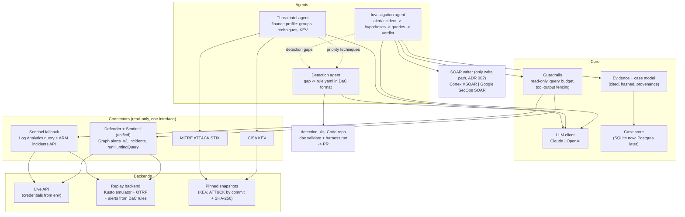

# 001. Platform architecture: three read-only agents over one connector layer

## Status
Accepted (2026-11-24)

## Context
The platform runs three LLM agents for a SOC: investigation, threat intelligence for the
finance sector, and detection engineering. Targets are Microsoft Defender (EDR / XDR) and
Microsoft Sentinel (SIEM), with the Sentinel workspace onboarded to the Defender portal.
No live tenant is available, so every component must run end to end without one, and
connecting a tenant must need credentials only. Test data is OTRF Security-Datasets.
Threat intelligence comes from CISA and MITRE ATT&CK. The LLM must be switchable between
Anthropic Claude and OpenAI.

Constraints from vendor and data sources (fetched 2026-11-24):

- OTRF holds raw Windows Security, Sysmon and Entra event logs. It has **no Sentinel
  incidents or alerts and no Defender `Device*` tables**.
- Defender alerts, incidents and advanced hunting are in Microsoft Graph v1.0:
  `GET /security/alerts_v2`, `GET /security/incidents`, `POST /security/runHuntingQuery`
  (permission `ThreatHunting.Read.All`). Sentinel alerts appear there once the workspace
  is onboarded to the Defender portal
  ([Graph security API overview](https://learn.microsoft.com/en-us/graph/api/resources/security-api-overview?view=graph-rest-1.0)).
- Sentinel incidents also have an ARM API:
  `GET .../providers/Microsoft.SecurityInsights/incidents?api-version=2025-09-01`
  ([Incidents - List](https://learn.microsoft.com/en-us/rest/api/securityinsights/incidents/list?view=rest-securityinsights-2025-09-01)),
  and log queries go to the Log Analytics query API.
- CISA KEV is published as JSON (mirror `cisagov/kev-data`, catalog 2026.11.23, 1,792
  entries; fields include `knownRansomwareCampaignUse`, `cwes`, `dateAdded`). It has **no
  sector field**.
- MITRE ATT&CK Enterprise STIX (v20.1, modified 2026-11-05) has 178 active groups and
  **no sector field**. 46 mention "financ" or "bank" in their description, including
  groups that are only "financially motivated".

## Decision

1. **Connectors.** Graph security API first: Defender and Sentinel alerts and incidents
   both come through `alerts_v2` / `incidents`, and `runHuntingQuery` runs KQL over both
   products' tables. The Sentinel ARM incidents API and Log Analytics query API are a
   fallback. One read-only `Connector` interface; each connector builds the exact HTTP
   request and sends it through a swappable `Transport`. Sentinel and Defender each have
   two backends:
   - **live**: the real API, credentials only from environment variables;
   - **replay**: the Kusto emulator (Kustainer) with OTRF loaded, so the agents run real
     KQL against a real engine. OTRF Sysmon events are also mapped to Defender `Device*`
     tables; every result from those tables is labelled as mapped by this project.
   Agents cannot tell which backend they are on.
2. **Alerts for replay.** OTRF has no alerts, so a seeding step runs the
   detection_As_Code rules over the loaded OTRF data in the emulator and writes the
   matches as `SecurityAlert` / `SecurityIncident` rows (Sentinel shape) and Graph-shaped
   alert JSON (Defender shape). Every seeded alert records the rule and dataset it came
   from.
3. **Investigation agent.** Input: an alert or incident ID. Loop: plan hypotheses ->
   write KQL -> run it through the connector -> record each result as evidence -> the
   LLM judges support or contradiction **citing evidence IDs**, which are validated ->
   stop on sufficiency, budget or "inconclusive". The input never names the expected
   outcome, evidence is never pre-labelled, and verdicts are generated from evidence.
4. **Threat intel agent (finance).** Pinned snapshots of ATT&CK STIX and CISA KEV,
   refreshed on demand. Finance relevance is **a curated, reviewed list** in
   `intel/finance_profile.yaml` (group IDs, each with the source sentence that ties it to
   finance targeting), because neither source has a sector field. Output: priority
   techniques and KEV entries, and a coverage gap list against the detection_As_Code
   rules.
5. **Detection agent.** Writes a rule folder in detection_As_Code's format (rule.yaml,
   attack.md, README.md, tests) into a detection_As_Code checkout, runs
   `python -m dac validate` and `python -m harness run --engine kusto`, and opens a PR
   there. It does not reimplement that pipeline, and nothing it writes merges without
   human review.
6. **LLM layer.** One `LLMClient` protocol (structured output against a Pydantic schema,
   token usage, cost) with Anthropic and OpenAI implementations. The model is chosen
   **per task, not per agent**: `reasoning` (hypotheses, evidence judgment, verdict) on
   the top tier (Claude Opus); `extraction` (query result summarising, log field
   extraction) and `writing` (reports, SOAR notes, docs) on Claude Sonnet or below.
   OpenAI equivalents are set the same way in settings. A spend tracker refuses new LLM
   calls once the month's cost reaches the cap (default USD 100) and marks running cases
   "stopped: budget". Prompts are versioned files.
7. **Safety.** Every data connector is read-only: no response actions (isolate device,
   disable user, close incident, reassign). The only write path is the SOAR writer
   (ADR 002). Tool output is passed to the LLM as fenced data, never as instructions,
   because log content is attacker-controlled. Per-case query and token budgets.
8. **Repo layout and docs**: `CLAUDE.md`, `BUILD_LOG.md` (append-only),
   `docs/decisions/`, `docs/components/`, `.claude/skills/`, pytest + ruff in CI.

## Alternatives considered
- **Hand-written alerts for replay.** Faster, but the investigation agent would only be
  tested on scenarios its authors wrote.
- **Defender tested on hand-written `Device*` rows only.** No invented field mapping, but
  no recorded data behind any Defender query. Mapping Sysmon is chosen, with labelling.
- **Detection agent writes rules in this repo.** Duplicates detection_As_Code's schema,
  validator and harness; drift is certain.
- **Sentinel ARM and Log Analytics APIs as the primary path.** Works without the Defender
  portal, but splits alerts and incidents across two APIs; kept as fallback.
- **An agent framework (LangGraph, CrewAI, vendor agent SDKs).** Hides the loop that has
  to be explainable to an analyst. Revisit if orchestration grows beyond three agents.

## Consequences
- Tests prove the requests match our reading of the vendor references and that the
  agents reason over real KQL results on recorded data. They do not prove a live tenant
  accepts the requests; that is "not verified" until a logged live call.
- Defender results on replay come from this project's Sysmon mapping, not from
  Defender itself.
- The finance profile is a judgment, not a source fact. It must stay reviewable.
- Depends on detection_As_Code staying compatible (rule format, `dac` and `harness`
  CLIs). Pin a commit; bump it deliberately.

## Open questions
- CISA sources beyond KEV (advisory pages list sectors in prose only). KEV first.
