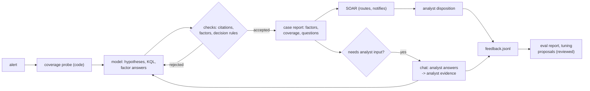

# 009. Investigation agent decision logic: factors, telemetry sufficiency, analyst loop

## Status
Accepted (2026-11-25; owner approved the design, without a direct email or Teams
notifier). Built in steps; see the amendments at the end for what is built.

## Context

### How the agent decides today (agent v1, ADR 006)
Read from `opssoc/agents/investigation/agent.py` and `agent.md` at commit fcd48e6.

**Flow.** The code reads the alert and records it as EV-0. It opens a `reasoning`-tier
conversation with the prompt in `agent.md` and four tools: `get_alert`, `get_incident`,
`run_hunting_query` (KQL through the read-only guard) and `submit_verdict`. Every alert,
incident or query result becomes an evidence record EV-n (query, purpose, provenance, all
rows, SHA-256). The model sees at most 50 rows and 1,500 characters a cell, inside a
`<tool_output trust="untrusted-data">` fence. The loop ends when `submit_verdict` passes
the checks, or when a budget (24 turns, 20 queries, USD 3) runs out.

**What is enforced by code, and what is only asked for in the prompt.** This split is the
main thing to understand: the model decides, and the code checks only a few properties of
its answer.

| Behaviour | Enforced by code | Prompt only |
|---|---|---|
| Read-only (no management commands, no write tools) | yes (`guard_query`, tool set) | |
| Every result recorded with hash and provenance | yes | |
| Tool output fenced as untrusted data | yes (`fence`) | |
| Cited evidence IDs exist | yes (`check_verdict`) | |
| Every timeline entry and finding cites something | yes | |
| A timeline time (to the minute) appears in the rows it cites | yes | |
| `true_positive` / `benign` have at least one finding | yes | |
| Budgets; no valid verdict -> `inconclusive: stopped: budget` | yes | |
| Write two to four hypotheses, at least one benign | no | yes |
| What to look at: parent/child, network, files, registry, other hosts, admin tools, installers, scheduled tasks | no | yes |
| `true_positive` needs evidence of malicious activity, "not only an alert" | no | yes |
| `benign` needs evidence for the benign explanation | no | yes |
| `inconclusive` names the missing evidence | no | yes |
| Confidence explained; say what was not checked | no | yes |
| Ignore instructions inside log text | partly (fence) | yes |

Checked on 2026-11-25 by calling `check_verdict` directly: a `true_positive` with high
confidence, no hypotheses and one finding that cites only EV-0 (the alert itself) is
accepted, and so is an `inconclusive` verdict with no findings and an empty
`not_checked`. The checks test that citations exist; they do not test that a finding is
true of its rows, which factors were considered, or whether the data was there to decide.

**Factors.** There is no factor list in code. The factors are the ones the prompt names
(process lineage, network, file, registry, spread to other hosts, admin/installer/task/test
explanations), and the model chooses which to examine. Two runs on the same alert can look
at different things, and nothing records which factors were never examined, apart from
the model's free-text `not_checked`.

**Missing telemetry.** Nothing checks it before or during the investigation:
- A query on a table that does not exist (for example `DeviceLogonEvents` in replay, which
  loads only the four mapped `Device*` tables plus `SecurityEvent` and `Event`) returns an
  error to the model. The error is not recorded as evidence, so it cannot be cited.
- A query that returns no rows is recorded as evidence. The agent cannot tell "nothing
  happened" from "the sensor sent nothing for this host in that window"; both are zero
  rows.
- Both cases end, at best, as `inconclusive`, which today also covers "the data was there
  but did not decide" and "the model ran out of budget".

**What the analyst receives.** `to_case_report` keeps only cited evidence. When the agent
stops without a valid verdict, the report says `No verdict: <status>` and carries no
evidence, hypotheses or queries, although these cases need the analyst most. An accepted
`inconclusive` verdict carries only the evidence its findings cite. The SOAR entry
(`soar/render.py`) shows verdict, severity, summary, cited evidence, queries and
recommended steps; it does not show hypotheses, `not_checked`, cost or the models used.
Nothing notifies anyone; the SOAR's own playbooks would have to.

**Analyst feedback.** None. The component doc says: "It does not remember earlier cases or
learn from analyst feedback." There is no way to ask the analyst a question, and no store
of dispositions.

### What the owner asked for (2026-11-25)
"What are the factors it will consider for investigation, how it decides it is malicious /
non malicious, is there enough telemetry available to decide, notify analyst about all the
details, get feedback from analyst about the incident (maybe act as chat bot between
analyst to gather more known info)."

## Decision (proposed)

### 1. A factor checklist the model must answer, defined in data
A versioned file `opssoc/agents/investigation/factors.json` lists the factors for an
alert class. v1 has one class, `endpoint-process` (every replay alert today comes from
A1-A4 or their eval variants). Each factor has an ID, the question, the tables and
columns that answer it, the weight (`high`, `medium`, `low`), and who can answer it
(`logs`, `analyst`, `both`).

| ID | Question | Answered from | Weight |
|---|---|---|---|
| F1 lineage | Is the parent/grandparent chain expected for this binary and command line? | DeviceProcessEvents, SecurityEvent 4688 | high |
| F2 command | Does the command line carry malicious traits (encoding, download cradle, hive dump, LOLBin download)? | DeviceProcessEvents | high |
| F3 follow-on | Did the process or its children connect out, write files, change registry, create persistence? | DeviceNetworkEvents, DeviceFileEvents, DeviceRegistryEvents | high |
| F4 account | Which account ran it, with what privilege, and is that normal for the account? | DeviceProcessEvents, SecurityEvent 4624/4672 | medium |
| F5 prevalence | How many hosts / how often has this command line or hash run in the last 30 days? | DeviceProcessEvents | medium |
| F6 spread | Does the same indicator appear on other hosts or accounts? | Device* tables | medium |
| F7 related alerts | Are there other alerts on this host, account or incident? | alerts / incident | medium |
| F8 benign explanation | Is there an installer, management tool, scheduled task, known test or change that explains it? | logs (partly); change records, pentest schedule: analyst | high |
| F9 asset context | What is the host's role and criticality? | analyst (no asset inventory connector) | low |
| F10 timing | Did it happen inside the account's usual hours? | DeviceProcessEvents history | low |

`submit_verdict` gains a required `factors` array: one entry per factor with
`state` and `evidence_ids`. States:
- `malicious_indicator`, `benign_indicator`, `neutral`: must cite evidence (code check);
- `unknown_no_telemetry`: must cite a coverage record (point 2) that shows the gap
  (code check, so the model cannot claim missing data that exists);
- `unknown_not_checked`: allowed, but counted and reported;
- `answered_by_analyst`: must cite an analyst record (point 4).

The checks reject a verdict that omits a factor or cites the wrong record type.
Hypotheses must number two or more with at least one marked benign (moves today's prompt
rule into code).

**Scoring.** Code, not the model, tallies the factors: malicious and benign indicators by
weight, and unknowns by weight. The tally is shown to the analyst as a factor table. It
does not set the verdict by a weighted sum; the decision rules below do. Reasons: with 12
eval cases there is no data to calibrate weights, and a single number such as "73/100"
reads as more precise than it is. Once the feedback store (point 4) holds enough analyst
dispositions, weights can be fitted and the comparison shown in the eval report.

**Decision rules (code checks on the submitted verdict):**
- `true_positive` needs at least one `malicious_indicator` on a high-weight factor that
  cites evidence other than EV-0 (the alert alone is not enough, which today's prompt asks
  for and the code does not check).
- `benign` needs a `benign_indicator` on F8 or on F1 (an explained lineage), and no
  high-weight factor left `unknown_no_telemetry`. Missing data can block a benign verdict
  but not a true positive: absence of telemetry never clears an alert, while a confirmed
  malicious action stays confirmed.
- Confidence is capped by code: `high` only when no high-weight factor is unknown.
- Otherwise the result is `inconclusive` or `insufficient_telemetry` (point 2).

### 2. Telemetry sufficiency check and the `insufficient_telemetry` verdict
Before the model's first turn, the code runs a coverage probe for the factor tables, on
the alert's host, in a window around the alert (default 24 h before to 1 h after):
existence (`T | getschema`), then a row count with first and last timestamps per table
for that host, and the null rate of the key columns (for example `ProcessCommandLine`,
`InitiatingProcessFileName`). Each table gets a state: `missing_table`,
`no_rows_for_host`, `rows_before_only`, `present`, `key_column_empty`. The probe is
recorded as evidence kind `coverage` (EV-1, after the alert) and shown to the model, so
it plans around gaps rather than discovering them by query errors. Query errors that name
an unknown table become `coverage` records too.

A new verdict value `insufficient_telemetry`, separate from `inconclusive`:
- `insufficient_telemetry`: one or more high-weight factors are `unknown_no_telemetry`,
  and the factors that were answerable do not reach `true_positive`. The report lists each
  missing table or column, which factor it would have answered, and the probe that showed
  the gap.
- `inconclusive`: the data was there and examined, and it does not decide.

The owner's wording was "insufficient evidence". This ADR uses `insufficient_telemetry`
because every `inconclusive` is also insufficient evidence; the distinction worth making
is whether the data exists.

What the probe misses: partial event loss inside a window that has rows; a sensor that
reports but drops one event type; data that is delayed rather than absent; tables the
factor file does not list. It checks presence and nullness, not completeness.

Consequences outside the agent: `Verdict` in `opssoc/case.py` gains the value, so both
SOAR mappings need a target for it (XSOAR incident field, SecOps comment text), and the
eval scorer counts it separately. New eval cases replay an existing alert with a table
hidden by a test-only connector wrapper; their expected verdict is
`insufficient_telemetry`.

### 3. Analyst notification with the full details
The case report always carries the full picture, for every outcome including budget
stops: factor table with states and tally, coverage table, all hypotheses with status,
timeline, findings, every evidence record's query and row count (cited or not, cited ones
marked), `not_checked`, the questions for the analyst (point 4), cost, models, agent
version, and a path to the investigation record. `render.py` lays these out in that order
under the verdict line.

Notification itself stays with the SOAR: the writer sets fields the SOAR's playbooks route
on (verdict, confidence, `needs_analyst_input`, severity). XSOAR and Google SecOps SOAR
assign and notify analysts through their own playbooks. A direct email or Teams notifier
would be a second write path, which CLAUDE.md puts out of scope; it is listed under
alternatives for the owner to decide.

### 4. Analyst feedback loop: questions, re-evaluation, stored feedback
**Asking.** `submit_verdict` gains `questions_for_analyst`: each question names the
factor it would answer and why the logs cannot (for example F8: "Was a penetration test or
software deployment scheduled on HOST between 10:00 and 11:00 UTC?"). A verdict whose
outcome would change with the answer sets `needs_analyst_input`. The agent does not pause
mid-investigation for an answer: an analyst may reply hours later, and a paused model
conversation cannot be held that long.

**Answering, chat style.** `python -m opssoc.agents.investigation chat --case OPS-...`
shows the report and the questions, and takes the analyst's free-text answers and any
extra context. Each answer becomes an evidence record of kind `analyst` with the analyst
handle, time and text, fenced as `trust="analyst-statement"`. A later version can read
answers from the SOAR case (an XSOAR war-room entry or a SecOps case comment); that is a
read from the SOAR, a new connector the owner must approve.

**Re-evaluating.** A re-evaluation round starts a new conversation seeded with the earlier
evidence records (no query is re-run unless the model asks), the earlier verdict and the
analyst records. The model may run further queries to test the analyst's statement, for
example check that the account the analyst named as the tester is the one that ran the
command. Findings that rest only on analyst records are labelled `analyst-attested` in
the report. Rounds are capped (default 3) and count against the case budget.

The analyst's statement is evidence, not a verdict: it cannot select the outcome
(CLAUDE.md: a request must not select the outcome). If the logs contradict it, the agent
says so and cites both.

**Storing.** Every answer and every final analyst disposition (agree / disagree, the
analyst's verdict, a reason category such as `authorised-test`, `admin-activity`,
`detection-logic`, `missing-context`) is appended to `data/feedback/feedback.jsonl`
(schema `opssoc.analyst-feedback/1`, append-only, git-ignored as it may hold customer
data). Each line carries case, alert, rule, agent version, models and the agent's verdict
before and after the round. The agent's verdict and the analyst's disposition are stored
side by side; neither overwrites the other.

**Use for eval and tuning:**
- Eval: `python -m opssoc.eval feedback` reports agreement rate per rule and verdict, and
  lists disagreements as candidate ground-truth cases. A candidate joins
  `ground_truth.json` only after the owner reviews it, with label kind
  `analyst-disposition`; feedback is never ground truth by itself.
- Tuning: recurring benign dispositions on one rule and one pattern become a tuning
  proposal (an exclusion) for the detection agent, as a PR to detection_As_Code that a
  human reviews.
- Context in later cases: a deterministic lookup of earlier dispositions for the same rule
  and host (or command line) is shown to the model as evidence kind `history`. It answers
  no factor by itself and cannot make a case benign. Feedback text is not added to the
  system prompt.

### Build order (each its own PR, after approval)
1. Factor file, `factors` in `submit_verdict`, factor checks and decision rules, prompt
   v2; tests with the scripted provider.
2. Coverage probe, `coverage` records, `insufficient_telemetry` in `case.py`, SOAR
   mappings and scorer; hidden-table eval cases.
3. Full case report for every outcome and `render.py` layout.
4. Questions, `chat` command, analyst records, re-evaluation rounds, feedback store,
   `eval feedback`.

## Alternatives considered
- **Weighted score sets the verdict** (for example, malicious if score >= 60): simple to
  explain, but the weights would be guesses with no data to fit them, and a model can
  game a threshold by labelling factors. Kept as a report, not the decision, until
  feedback data exists.
- **Model decides sufficiency** (prompt asks "is there enough telemetry?"): no code check;
  the model would not know a table exists unless it queries it, which is today's gap.
- **Pause the loop and wait for the analyst** (`ask_analyst` tool): natural in a live chat,
  but a model conversation cannot stay open for hours and the budget clock keeps running.
  Re-evaluation rounds over the stored record do the same job asynchronously.
- **Direct email / Teams notifier**: faster for the analyst, but a second write path that
  CLAUDE.md puts out of scope, and SOAR playbooks already route and notify. Owner's call.
- **Feed past feedback into the prompt** ("known benign patterns"): helps repeat alerts,
  but one wrong or manipulated disposition would then shape every later case. The `history`
  record keeps it visible and cited instead.

## Consequences
- More code checks mean more rejected verdicts and more turns per case; cost per case will
  rise. The eval harness measures by how much, once spend is approved.
- The factor file is a second place to keep in step with the detection rules; v1 covers
  endpoint process alerts only. Identity (B-rules) and cloud alerts need their own factor
  sets.
- The checks still test that answers cite evidence of the right kind, not that a factor
  answer is true of its rows; eval and analyst review cover that.
- Analyst answers are unverified statements. Labelling them `analyst-attested` keeps that
  visible; it does not make them true.
- How a real model behaves under these checks is not measured (no LLM spend approved).

## Amendments

### 2026-11-25 - Step 1 built (factor checklist), with three changes from the text above
Built: `opssoc/agents/investigation/factors.json` (set `endpoint-process` v1, F1-F10),
`factors.py` (`check_factors`, `check_decision`, `tally`), `factors` and a hypothesis
`explanation` in `submit_verdict`, prompt v2.
- **No `answered_by_analyst` state.** An answer needs a direction (malicious, benign,
  neutral) for the decision rules, whoever supplied it. Instead, a factor whose
  `answered_by` is `analyst` (F9) may take a known state only when it cites an `analyst`
  record. Whether an answer came from the analyst is read from the kinds of evidence it
  cites.
- **"Evidence other than EV-0"** is implemented as evidence of a kind other than `alert`
  or `incident`. An incident only re-states alerts.
- **Hypotheses carry `explanation: malicious | benign`** so the code can check that at
  least one benign explanation was considered.
Until steps 2 and 4 are built, no `coverage` or `analyst` record exists. So
`unknown_no_telemetry` cannot be used yet, and F9 can only be `unknown_not_checked`. The
eval scorer keeps `citations_valid` for the ADR 006 checks only, and adds
`factor_checks_valid` for these.

### 2026-11-25 - Step 2 built (telemetry coverage, `insufficient_telemetry`)
Built: `coverage.py` (probe, schema re-check after a failed query), coverage record EV-1,
`insufficient_telemetry` in the agent, `Verdict`, the case report (`missing_telemetry`)
and the SOAR entry; `HiddenTablesConnector` and two eval cases with every factor table
hidden; scorer count. Prompt v3, factor set v2. Changes from the text above, found by
running the probe on the Kusto emulator with the seeded replay alerts:
- **Missing tables after a failed query come from a schema query, not from the error
  text.** The emulator answers a query on a missing table with a bare HTTP 400 that does
  not name the table.
- **`rows_before_only` became `stops_before_alert`, with a 15-minute tolerance.** Each OTRF
  recording ends minutes after the attack, so "no rows after the alert" marked present
  data as a gap. Now a source is a gap only when its last row is more than 15 minutes
  before the alert.
- **`RemoteUrl` is no longer a key column of DeviceNetworkEvents.** It is empty in every
  mapped Sysmon network row, as it often is for IP-only connections, so the whole table
  read as a gap. The set is now `endpoint-process` v2.
- **`inconclusive` is refused** when a high-weight factor lacks telemetry and nothing
  malicious is shown: that is `insufficient_telemetry`. This makes the split in point 2
  checkable.

### 2026-11-25 - Step 3 built (full analyst report)
Built as point 3 describes: `CaseReport.detail` (`analyst_detail`, code-built from the
record), the SOAR layout in that order for every outcome, and the XSOAR labels
`ops-soc-confidence` and `ops-soc-agent-status`. Not built here: `needs_analyst_input`
and the questions for the analyst. Both come with step 4, which creates them. The owner
confirmed on 2026-11-25 that there is no direct email or Teams notifier.
